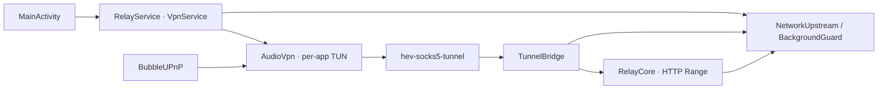

# 开发说明

## 架构



`RelayService` 管理前台会话。`AudioVpn` 在当前物理网络上解析加速域名，安装 IPv4 /32 和 IPv6 /128 路由，仅允许 BubbleUPnP 进入 TUN。地址未变时会沿用 TUN。原生引擎通过仅本机可达、每会话随机认证的 SOCKS 通道将 TCP 交给 `TunnelBridge`。匹配的 HTTP 请求直接由 `RelayCore` 在该套接字上响应，共享地址上的其他 TCP 请求绑定到物理网络原样转发。

`core` 使用纯 Java，上游通过 `RelayCore.Opener` 注入，JVM 使用合成上游。18889 回环是 Debug 专用测试入口。原生依赖版本、校验和与源码见 [app/libs](../app/libs/README.md)。

## 并发与资源

- 任务缓存由 `jobs` 锁保护，网络预检在锁外执行。同 URL 的等待者共享同一轮预检结果，失败后新的请求可以重新预检。不同 URL 可并行，创建中的任务计入最多两个任务的容量。
- 缓存块最多 256 KiB，单个上游 Range 可覆盖最多 4 个相邻块。下游直接写出已验证的缓存字节。顺序读取从一路开始，持续等待时按 1→2→4→8→16 增加并发，以用户所设上限为准。增加并发后先分配靠近读者的缺口，连续数据积累后逐步回落。下游停止读取时，窗口停止向前推进。
- 两个任务的缓存总上限为 24 MiB，空闲任务只保留最近 4 块。跳播时取消已无读者需要的在途范围。源站响应提前结束时从缓存内已验证的下一个字节继续，成功消费的响应交给 HTTP 层复用连接。
- 全局上游配额为 1–16，包含预检。调整配额时唤醒正在等待数据的读者并重算预取窗口。降低配额时，超出窗口的预取会取消，仍需使用的已有连接可以完成。重试退避期间归还连接配额，空闲取流线程超时退出。
- 临时预检和分块失败最多尝试 3 次。无 `Retry-After` 的 502、503 和 504 可按原范围重试。授权拒绝、协议错误及内容范围或版本校验失败直接结束。
- `If-Range` 条件在 Range 解析前判断；过期或弱 ETag 条件返回完整内容。HEAD 忽略 Range。语义依据 [RFC 9110](https://www.rfc-editor.org/rfc/rfc9110.html#name-if-range)。
- 取流期间每秒更新通知，空闲时每 5 秒检查服务。网络变化和请求开始或结束时立即调度。诊断在后台优先级线程写盘，空闲缓存和 CPU 唤醒锁按到期时间回收。
- 诊断有活动时每 10 秒采样，空闲时每 60 秒采样。后台调度恢复后即时采样。周期写盘只保存最近 24 条采样和 60 条事件，手动导出和停止服务时保存完整的有界历史（最多 900 条采样和 200 条事件）。诊断中的 `cached_audio_bytes` 记录当时已分配的音频缓存。
- 前台会话与监听就绪分别表示。监听失败保留开启意图，由服务自动恢复，不依赖 Activity 的 `onResume`。
- 已通过目标校验的 GET 和 HEAD 在预检前获取唤醒锁。最后一个请求结束约 8 秒后释放 CPU 唤醒锁。
- 会话只持有一个允许 Wi-Fi 或蜂窝的非 VPN 网络请求，由 Android 选择当前网络。上游 HTTP 连接绑定到该网络并使用 `Proxy.NO_PROXY`。停止服务时释放网络请求。

Rill 用本地套接字成功发送的字节推进窗口，由缓存上限约束预取。上游合并读取可参考 rclone 的顺序 Range 读取，低缓冲转发可参考 NGINX 的上游读取循环。 [rclone 源码](https://github.com/rclone/rclone/blob/master/fs/chunkedreader/sequential.go) · [NGINX 低缓冲转发源码](https://github.com/nginx/nginx/blob/master/src/http/ngx_http_upstream.c#L3694)

## 运行约定

包名为 `app.rill.android`，设置存于 `rill` SharedPreferences。诊断为 `relay-result.json`。

最低 API 29，compileSdk / targetSdk 34。版本只在根目录 `gradle.properties` 修改，诊断使用 `BuildConfig.VERSION_NAME`；健康检查返回稳定的 `Rill ready`。

## 本地检查

环境与完整构建命令见 [README](../README.md)。

```powershell
.\gradlew.bat :core:test       # JVM 回归与本地 HTTP 集成测试
.\gradlew.bat formatJava       # Google Java Format
.\gradlew.bat checkJavaFormat  # 只检查格式
.\gradlew.bat :app:connectedDebugAndroidTest
```

设备测试应在独立 Android 13+ 模拟器上运行。服务测试会修改测试应用设置、启停服务及切换 `AndroidWifi`；真实设备自动跳过服务测试。VPN 授权仅在隔离模拟器中为回归测试预置。Debug 与正式包签名不同，切换前需在独立模拟器中移除旧测试安装。

CI 对提交、PR 和版本标签运行 JVM 测试、Debug 构建、Debug / Release Lint 和格式检查，保留报告及 Debug APK 14 天。正式签名仅在发布机器配置，不上传到 CI。

改动取流行为应覆盖 Range、字节完整性、上游失败、重试和关闭。涉及 Android 生命周期的改动还应运行 [后台测试](background-testing.md)。

## 维护约定

只维护 `app/src`、`core/src` 中的现行源码；历史版本交给 Git 与 Releases。APK、缓存、SDK 路径、密钥和个人订阅均不提交。第三方许可统一存放于 `licenses/`，构建时打包进 assets。

依赖固定为 hev-socks5-tunnel 2.20.0、JUnit 4.13.2、Google Java Format 1.24.0；工具链固定为 AGP 8.7.3 / Gradle 8.9 / JDK 17。升级工具链和 targetSdk 时应独立验证行为变化。
