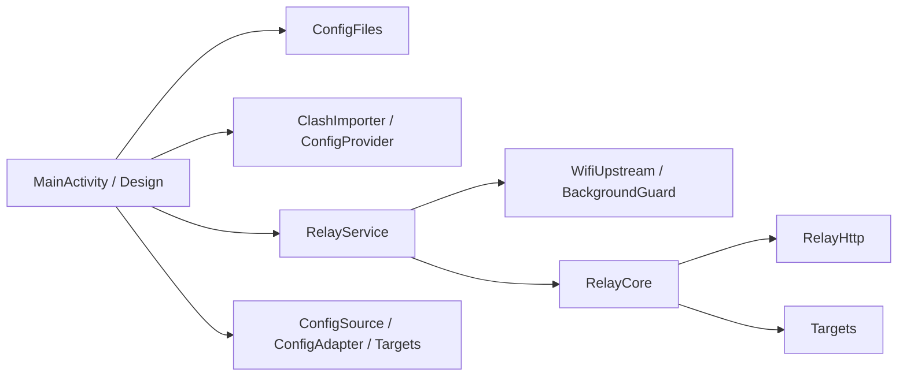

# 开发说明

## 架构



| 层 | 职责与边界 |
| --- | --- |
| Android 界面 | `MainActivity` 组织连接、配置和记录页面；`Design` 统一样式 |
| Android 配置 | `ConfigFiles` 管理私有配置文件的原子写入；`ClashImporter` 创建不可变快照；`ConfigProvider` 仅提供授权读取 |
| Android 会话 | `RelayService` 管理前台会话、监听恢复、采样与异步诊断；`WifiUpstream` 注入 Wi-Fi 连接；`BackgroundGuard` 管理会话锁 |
| Java 中继 | `RelayCore` 管理连接配额、任务、分块、缓存和重试；`RelayHttp` 管理有界 HTTP 解析与单段 Range |
| Java 配置 | `Targets` 校验允许来源；`ConfigSource` 有界读取和下载；`ConfigAdapter` 安全解析及生成 YAML |

`core` 不引用 Android API。网络通过 `RelayCore.Opener` 注入，JVM 测试使用本地合成上游。UI 保持原生 Java View，读取进程内服务状态；更换绑定或状态模型需要单独验证生命周期。

## 并发与资源

- 任务缓存由 `jobs` 锁保护，网络预检在锁外执行。同 URL 合并预检，不同 URL 可并行；创建中的任务计入最多两个任务的容量。
- 每个任务最多 48 个 256 KiB 分块，即 12 MiB 数据缓存；两个任务合计最多 24 MiB，不含连接和其他运行开销。
- 全局上游配额为 1–16，包含预检；降低配额后允许已有连接完成。
- 临时预检和分块失败最多尝试 3 次；协议、内容范围或版本校验失败直接拒绝。
- `If-Range` 条件在 Range 解析前判断；过期或弱 ETag 条件返回完整内容。HEAD 忽略 Range。语义依据 [RFC 9110](https://www.rfc-editor.org/rfc/rfc9110.html#name-if-range)。
- 服务维护、网络回调、诊断写盘分别使用独立线程；停止时关闭监听、客户端、上游、任务及线程。
- 前台会话与监听就绪分别表示。监听失败保留开启意图，由服务自动恢复，不依赖 Activity 的 `onResume`。
- CPU 锁与 Wi-Fi 网络请求随会话释放；Android 14 起不再依赖旧式 Wi-Fi 高性能锁维持后台运行。

配置读取和适配在单独 I/O 线程完成，失败时保留上次可用结果。`ConfigFiles` 对每个文件使用 `AtomicFile`，中断写入回滚该文件；两个文件不构成跨文件事务。改动配置提交逻辑时，应保持该边界明确。

## 兼容性

保留包名 `app.rill.android`、Manifest 组件名、Provider authority、`rill` SharedPreferences 及现有设置键。配置路径为 `source.yaml`、`adapted.yaml`、`shared/`，诊断为 `relay-result.json`。

最低 API 26，compileSdk / targetSdk 34。版本只在根目录 `gradle.properties` 修改，诊断使用 `BuildConfig.VERSION_NAME`；健康检查返回稳定的 `Rill ready`。

## 本地检查

环境与完整构建命令见 [README](../README.md)。

```powershell
.\gradlew.bat :core:test       # JVM 回归与本地 HTTP 集成测试
.\gradlew.bat formatJava       # Google Java Format
.\gradlew.bat checkJavaFormat  # 只检查格式
.\gradlew.bat :app:connectedDebugAndroidTest
```

设备测试应在独立 Android 13+ 模拟器上运行。服务测试会修改测试应用设置、启停服务及切换 `AndroidWifi`；真实设备自动跳过服务测试。配置文件测试只使用测试专用的临时缓存子目录。Debug 与正式包签名不同，切换前需在独立模拟器中移除旧测试安装。

CI 对提交、PR 和版本标签运行 JVM 测试、Debug 构建、Debug / Release Lint 和格式检查，保留报告及 Debug APK 14 天。正式签名仅在发布机器配置，不上传到 CI。

改动取流行为应覆盖 Range、字节完整性、上游失败、重试和关闭；改动配置行为应覆盖重复适配、名称冲突、非法输入与大小上限。涉及 Android 生命周期的改动还应运行 [后台测试](background-testing.md)。

## 维护约定

只维护 `app/src`、`core/src` 中的现行源码；历史版本交给 Git 与 Releases。APK、缓存、SDK 路径、密钥和个人订阅均不提交。第三方许可统一存放于 `licenses/`，构建时打包进 assets。

依赖固定为 SnakeYAML 2.4、JUnit 4.13.2、Google Java Format 1.24.0；工具链固定为 AGP 8.7.3 / Gradle 8.9 / JDK 17。升级工具链和 targetSdk 时应独立验证行为变化。
